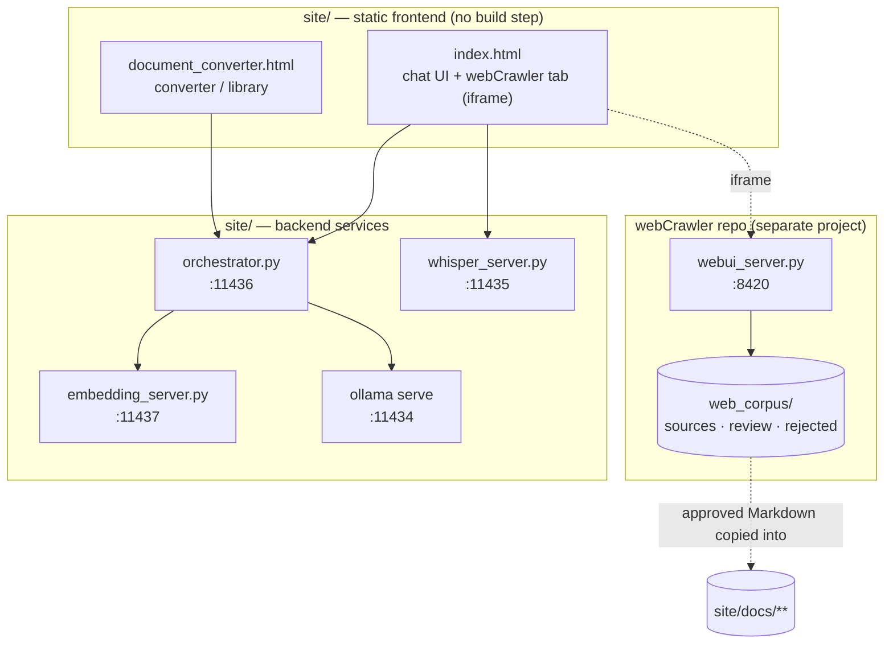
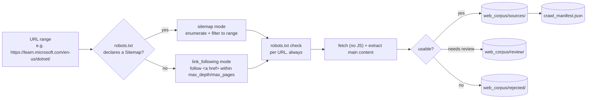
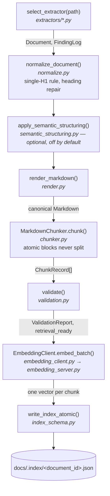
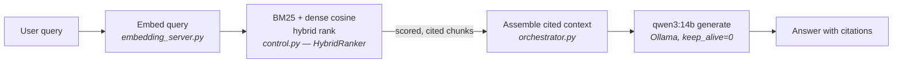
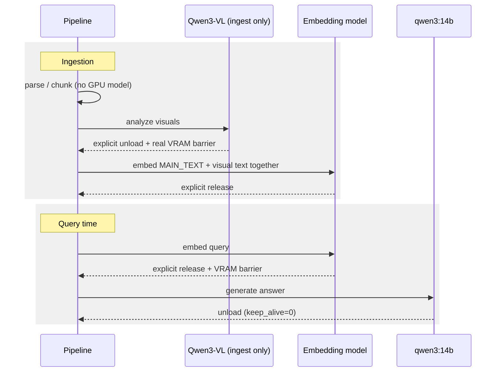
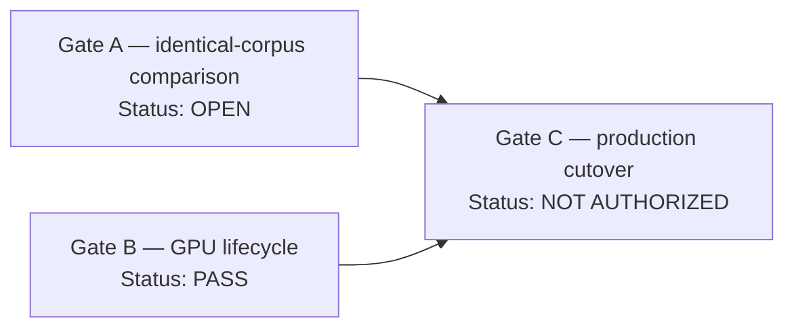

# Local RAG System — Handoff

A fully local, private, document-grounded RAG system running on one desktop:
ingest source documents → extract main-body text → semantic chunk → hybrid
index (BM25 + dense) → retrieve → cite → answer with a local Ollama model.
No document content or query ever leaves the machine.

**Host:** Pop!_OS · RTX 3060 12GB · ~94GB RAM
**Root:** `/home/jrochau/Projects/site`
**Indexed docs:** 408 in `docs/.index` (as of 2026-09-30) · 18 in the Qwen shadow index

This page is a synthesis for orientation. For anything load-bearing, go to
the canonical documents:

- `RAG_BUILD_SOURCE_OF_TRUTH.md` — the canonical, incrementally-updated
  build handoff: full architecture rationale, every validation gate, GPU
  measurements, visual-retrieval design, and a dated change log back to v1.0
- `DELIVERABLES.md` — the `document_converter` pipeline rewrite: full
  data-flow, migration results, bugs found/fixed, explicit scope cuts and why
- `../webCrawler/HANDOFF.md` and `../webCrawler/README.md` (sibling
  project, `/home/jrochau/Projects/webCrawler`) — the web-crawling tool's
  own handoff and full pipeline documentation
- `TABLE_SPLIT_TOKEN_ACCOUNTING_ANALYSIS.md` — table/atomic-block splitting
  analysis + the 2026-09-23 drop-warn-succeed policy (§6 of that doc)
- `site_audit.md` — 2026-09-26 read-only fact audit of the whole repo
  (layout, env vars, every route, models, tests, deps) with `file:line` evidence
- `artifacts/heading_classifier_step1/README.md` — heading-classifier
  measurement pass (D1–D7), read-only, no code changed

---

## 0. What changed since the 2026-08-31 handoff

- **Index grew 157 → 408 docs**, mostly the 31,134-page SQL Server PDF
  (`docs/newly_formatted_docs_review/sources/sql-sql-server-ver17.pdf`),
  ingested as 88 parts via the new splitter, plus Azure crawl content.
- **`split_ingest.py` (new)** — pre-ingest PDF splitter. Splits a huge PDF on
  its own outline/bookmark tree into ~5MB whole-structural-unit parts, each
  run through the normal `DocumentPipeline.index()`. Deterministic. Touches
  nothing downstream.
- **`atomic_split.py` (new) + drop-warn-succeed policy (2026-09-23)** —
  oversized code/tables/lists are now subdivided at semantic boundaries with
  reconstruction metadata, measured against the real serialized render.
  A block that truly can't fit is **dropped with a WARNING
  (`oversized_atomic_block`) and the document still succeeds** — it is no
  longer a hard stop. Oversized paragraphs are force-split in every profile.
- **`heading_demotion.py` (new)** — active false-heading demotion pass on the
  shared pipeline path for every extractor (UI chrome, pseudocode fragments,
  captions, checkbox headings, repeated boilerplate).
- **`section_numbering_audit.py` (new)** — flags repeated top-level section
  numbers; renumbers only when unambiguous. Uses ASCII `[0-9]`, not `\d` —
  fixes Microsoft Learn "docons" icon glyphs (fullwidth `７`) being parsed as
  section numbers and rewriting every "Note" callout.
- **`docling_extractor.py` (new, off by default)** — `PARSER=docling` flag.
  Shells out to the isolated `.venv-docling/` (~5.5GB). Never pass
  `--enrich-formula`. `pdf_extractor.py` stays the default + fallback.
  `.venv-xberg/` is a parked alternative from the same layout PoC.
- **`embedding_server.py`** — OOM-specific retry around `model.encode`.
- **Heading-classifier hardening, step 1 (measurement only)** —
  `artifacts/heading_classifier_step1/`. Key findings: the native PDF heading
  path (`_is_heading_line`, `pdf_extractor.py`) is a single font-size-bucket
  boolean with no signal scoring or instrumentation, so D2 halted; 309/389
  docs had zero raw validation errors; `retrieval_ready` is `True` for every
  doc, so it doesn't discriminate quality. **Step 2 (the actual classifier
  fix) has not started.**
- **Test suite:** 555 tests collected (not re-run for this handoff).

### Where work stopped / next up

1. Heading classifier step 2 — add multi-signal scoring to the native PDF
   heading path, using the D1–D7 findings.
2. The SQL anthology is still structurally noisy. Latest baseline
   (`run_anthology_baseline.py`, `run_anthology_after.out`): 29,871 H2s,
   4,876 errors (4,722 `empty_section`), 5,328 `suspicious_heading` — yet
   `retrieval_ready: true`. The `run_anthology_*` / `extract_*` /
   `capture_regression_headings.py` scripts at the root are the ad-hoc
   harness for this; output goes to `/tmp`.
3. Embedding cutover Gate A (§11) — still not run.
4. Housekeeping: stray `*.bak` / `*.orig` files in `document_converter/`
   and `extractors/`; `orchestrator.log` is ~311MB of DEBUG output
   (tesseract/PIL); `sessions/` is empty.

---

## 1. Overview

This is a private, offline knowledge assistant: source documents (typed in
by hand, or pulled from the public web by a companion crawler) feed a
document ingestion/conversion pipeline, which feeds a hybrid search index,
and a chat UI answers questions grounded in that index using a local LLM.
It is **not** a document-reconstruction tool — it doesn't try to
faithfully rebuild page layout, figures, or publication furniture; it only
needs to extract what's useful for retrieval.

**Two repos, one system.** This repo (`site/`) owns ingestion, indexing,
retrieval, and both UIs. A sibling repo, **`webCrawler/`**
(`/home/jrochau/Projects/webCrawler`), owns turning permitted public web
pages into the same clean, provenance-tracked Markdown format this
pipeline already expects — it's a source-acquisition tool that feeds this
one, not a separate product. See §3.

**What it does well today:** ingests Markdown, TXT, HTML, DOCX, legacy DOC,
and PDF (incl. OCR and scanned pages) into a structurally-validated,
provenance-carrying chunk index; answers are cited back to source
document/heading/page.

**What's mid-flight:** a planned embedding-model migration (BGE →
Qwen3-Embedding-4B) is validated in a shadow index but **not cut over** —
production still runs on BGE. See §11. Heading-classifier hardening is
measured (step 1) but not implemented. See §0.

---

## 2. Services & ports

Five independent local processes across the two repos. None auto-start;
none stay running when not in use — that's intentional (frees GPU/RAM).

| Service | File | Port | Owns |
|---|---|---|---|
| Ollama | `ollama serve` | 11434 | Answer-generation model (`qwen3:14b`) and, at ingest time only, the visual-analysis model (`qwen3-vl:8b`) |
| Whisper STT | `whisper_server.py` | 11435 | Mic dictation for the chat UI (faster-whisper, local only) |
| Orchestrator | `orchestrator.py` | 11436 | FastAPI app: routing, state, threads, document + search endpoints |
| Embedding server | `embedding_server.py` | 11437 | The one sentence-transformers model process (currently `BAAI/bge-large-en-v1.5`) |
| webCrawler UI | `../webCrawler/webui_server.py` | 8420 | Crawl jobs + browsing `web_corpus/` (separate repo — see §3) |



> **Workflow:** start services when you need them, stop them when done.
> Closing the browser tab does **not** stop backend processes or free
> VRAM — only killing the owning process does.

---

## 3. Web crawler (source acquisition)

**Separate sibling repo:** `/home/jrochau/Projects/webCrawler`. Its job
ends where ingestion begins — it turns a permitted public web page into
clean, provenance-tracked Markdown (YAML front matter for provenance +
body for retrieval content); it does not archive pages, preserve layout,
run a browser, or execute JavaScript. A page whose real content only
exists after client-side rendering is routed to `web_corpus/review/`
(`reason: requires client-side rendering`) rather than silently accepted.



**How it connects to this repo:** the crawler's own `web_corpus/`
(`sources/` / `review/` / `rejected/` + `crawl_manifest.json`, an
audit trail of every URL crawled — status, robots decision, content hash,
rejection reason) is separate storage, not shared with `site/docs`.
Getting a crawled page into the RAG index is a manual step: review
`web_corpus/`, then copy the accepted Markdown into `site/docs/**`
(e.g. `docs/azure/...`, which is why per-topic `crawl_manifest.json`
copies show up there too) for the normal ingestion pipeline (§4) to pick
up. There is no automatic crawler → index pipeline today.

**Access:** a `webCrawler` tab in `index.html`'s left nav embeds the
crawler's own UI as an iframe pointed at `http://127.0.0.1:8420` (editable
in the UI, or "Open in new tab"). The crawler UI itself is served by
`webui_server.py` — one process serves both its API and its frontend, no
separate static file server. Start it with:

```bash
cd /home/jrochau/Projects/webCrawler
source .venv/bin/activate
python webui_server.py            # :8420
```

Or drive it headless with no UI at all:

```bash
python crawl.py https://example.com/docs/product/ --max-pages 20 --max-depth 3 --delay 1.0
```

**Notable design points:**

- **Locale segments are not filtered automatically** — the URL range must
  include the locale (e.g. `/en-us/`) or the corpus fills with
  near-duplicate translated pages.
- **A pasted robots.txt is authoritative** and never merged with the live
  file; "Fetch live (preview)" only prefills the box for review.
- **Cancellation is cooperative**, not a process kill — the in-flight URL
  always finishes and is written normally; only the next one is skipped.
  Never leaves a half-written document or manifest entry.
- **Job history** (`.webui_state/jobs.json`, capped at 50, atomic writes)
  is execution metadata only — not full logs, not corpus content. A job
  still `running` when the server dies is reconciled to `interrupted` on
  next startup rather than staying phantom-"running" forever.
- **No auth** — local single-user tool, not meant to be exposed beyond
  `127.0.0.1`.

## 4. Ingestion pipeline

`document_converter.DocumentPipeline` is the single entry point every
caller (CLI, legacy scanner, orchestrator upload) goes through — one
format-agnostic pipeline, no per-format forks downstream of extraction.



Document identity is a hash of the file's **path** relative to its scan
root, not its content — re-processing the same path overwrites the same
index entry atomically (temp file + `os.replace`, so a crash never leaves
a half-written index).

### Two retrieval profiles, one parser

Selected via `--profile` / `DOCPIPE_PROFILE`. Both reuse the exact same
extraction/normalization result — there is no second parser, only a filter
and a gating policy layered on top.

| Profile | Description |
|---|---|
| **MAIN_TEXT** (default) | What actually gets embedded and searched: title, headings, body prose, lists, code, tables. Excludes author/affiliation, copyright/publication metadata, figures/captions, table-of-contents, references. Gates only on retrieval-critical errors. |
| **FULL_FIDELITY** | The complete, unfiltered document — every block, every excluded region — for parser diagnostics and future document-reconstruction work. Gates on full structural validation. |

Formats supported: Markdown, TXT, HTML, DOCX, legacy DOC (via local
LibreOffice headless conversion), PDF (including OCR via local Tesseract,
multi-column reading order, and both raster and vector-drawn visual
charts/diagrams). `PARSER=docling` swaps in the Docling extractor (off by
default). PDFs too large to process as one object go through
`split_ingest.py` first.

Shared post-extraction passes now also include `heading_demotion.py`
(false-heading demotion) and `section_numbering_audit.py` (repeated
top-level numbering); oversized atomic blocks go through `atomic_split.py`
from both the preview and index paths, so chunk boundaries never drift.

`strict: true` by default — a document with any
`ERROR`-severity finding is not indexed at all; no partial index is ever
written.

---

## 5. Query & generation

Hybrid retrieval, then a grounded, cited answer from a local model.



`control.py` is pure, stateless scoring logic (BM25 + cosine), called by
the orchestrator — never touches models or I/O itself. Retrieval never
mutates the shared `DocStore` chunk records in place (an earlier
concurrency bug where one in-flight request's scores could be clobbered by
another was found and fixed, with a regression test).

---

## 6. GPU / VRAM lifecycle

The load-bearing rule of this whole system: on a 12GB card, GPU-resident
models must never overlap when they don't have to.

**Strict sequential ownership.**



Built on two shared primitives: `document_converter/gpu_lifecycle.py`
(real GPU-state polling, VRAM barrier, Ollama unload — degrades gracefully
with no GPU present) and `embedding_server.py`'s `POST /api/release`
(on-demand VRAM release without a process restart). A process-wide lock in
the orchestrator (`GPU_STAGE_LOCK`) keeps an upload and a search from
reaching the GPU concurrently; generation deliberately runs outside that
lock so it doesn't serialize behind an unrelated request.

> **Measured:** Qwen3-VL ingestion ~7000–7050 MiB above baseline ·
> qwen3:14b generation ~9450–9460 MiB above baseline · embedding models
> never resident alongside either, by construction — validated with real,
> not simulated, GPU measurements.

---

## 7. Orchestrator API

FastAPI app on `:11436` (docs at `/api-docs`).

| Route | Purpose |
|---|---|
| `GET /health` | Liveness check |
| `GET /gpu/status` | Read-only GPU/model-residency diagnostic: real VRAM use, every GPU-compute process (so an unrelated app like a game is visible, not confused for this project), Ollama's resident models, embedding-service health |
| `GET`/`PUT /state` | Session state (goal, tasks, constraints, decisions) — a small persistent scratchpad |
| `POST /ingest` | Rescan the legacy `docs/**/*.md` tree and index anything new or changed |
| `GET /docs`, `/docs/{id}` | List / detail indexed documents |
| `GET /docs/{id}/raw`, `/markdown` | Fetch a document's original file or its converted Markdown |
| `POST /docs/search` | Hybrid BM25+dense search over the index |
| `POST /docs/preview` | Run extraction/chunking on an uploaded file with nothing written and no embedding call — offline dry-run |
| `POST /docs/upload` | Full pipeline: extract → normalize → chunk → validate → embed → index, synchronous, one response |
| `PUT`/`DELETE /docs/{id}/title` | Manual per-document title override (metadata correction, not a second title system) |
| `DELETE /docs/{id}` | Remove a document from the index |
| `GET`/`POST /threads`, `GET`/`PUT`/`DELETE /threads/{id}` | Chat thread CRUD |
| `POST /chat/stream` | Server-sent-events streaming chat response |
| `POST /session/end` | Summarize a finished conversation and extract state deltas, saved under `sessions/` |

No live progress stream during upload today — `/docs/upload` runs
synchronously and returns one `stages` object; the UI shows a single
status line rather than a per-stage bar.

---

## 8. Frontend

A single static HTML page, no build step, opened directly or served as a
file: **`index.html` — Knowledge Assistant.** It uses `app.css` and owns /
loads no ML model — the orchestrator does. One sidebar switches between
three views:

- **Chat** — the streaming chat UI, with mic dictation through the Whisper
  server. Sends `keep_alive: 0` on generation so the answer model unloads
  right after each reply. The Sources panel is hidden (zero width) until
  the active conversation actually has retrieved sources; the `Sources (N)`
  header pill then toggles it — a third column on wide windows, an overlay
  drawer at or below 1100px.
- **Knowledge Base** — the single document-management page: upload
  (dropzone, full pipeline commit), the indexed-document list with
  per-row title override (edit / restore automatic) and expandable
  validation diagnostics (View Details), rescan-docs/ + refresh buttons,
  and a dry-run convert-to-markdown dropzone (`/docs/preview`) whose
  result cards show chunk counts + validation findings and offer an
  optional "commit to KB" (`/docs/upload`) with a pre-index title edit.
- **Settings** — system prompt, project state, agentic-capability toggles.

The old `document_converter.html` page is gone — everything it did was
merged into the Knowledge Base view above.

---

## 9. Storage & data

| Path | Contents |
|---|---|
| `docs/.index/<document_id>.json` | One index payload per document, schema_version 2 — chunks, embeddings, provenance, resolved title, profile |
| `docs/.index/_meta/title_overrides.json` | Manual title-override sidecar, keyed by document_id |
| `docs/**/*.md` | The legacy hand-authored study-note corpus, scanned by `ingestion.py` |
| `threads/*.json` | Chat thread transcripts |
| `sessions/*.json` | Raw saved sessions from `/session/end` |
| `state.json` | Persistent scratchpad state (goal, open tasks, decisions) |
| `manifest.json` | Legacy ingestion manifest |

---

## 10. Configuration

One shared config tree, loaded once, imported everywhere —
`ingestion.py`, `orchestrator.py`, and the CLI all load the same object.

```
document_converter/config.py — PipelineConfig
  1. built-in defaults
  2. docpipe.yaml / docpipe.json  (or $DOCPIPE_CONFIG)
  3. environment variables         (highest priority)

covers: paths · embedding host/model · chunk budgets ·
        OCR mode · strict mode · upload limits · retrieval budget
```

### CLI

```bash
python -m document_converter.cli preview  path/to/file.pdf   # print chunks, write nothing
python -m document_converter.cli validate path/to/file.docx  # findings report only
python -m document_converter.cli process  path/to/file.html  # + normalized .md + report
python -m document_converter.cli index    path/to/file.md    # + embeds + writes docs/.index/<id>.json
python -m document_converter.cli scan     <dir> [--force]    # index every supported file under <dir>
python -m document_converter.cli rebuild  [--force]          # re-index the whole configured corpus
```

---

## 11. Embedding model status

A migration is in flight. **Production has not been switched — treat BGE
as the only live embedding space.**

| | Model | Status |
|---|---|---|
| Production — live | `BAAI/bge-large-en-v1.5`, 1024-dim | Backs all 408 currently-indexed documents in `docs/.index` |
| Candidate — shadow only | `Qwen/Qwen3-Embedding-4B`, 2560-dim, batch size 2 (avoids RTX 3060 OOM) | Matched or beat BGE on every tested query in shadow comparisons |

Cutover gates, per the source-of-truth document:



- **Gate A — identical-corpus comparison:** BGE vs. Qwen over the exact
  same document set, same queries. Not yet run.
- **Gate B — GPU lifecycle:** sequential embed→release→generate lifecycle
  proven on both backends (§6).
- **Gate C — production cutover:** blocked on Gate A. Old BGE index must
  be preserved until Qwen is proven stable.

---

## 12. Known limitations

- **Unsplittable oversized atomic blocks are dropped, not indexed.** Since
  2026-09-23 the document succeeds, but that block's content isn't
  searchable. Check `dropped_block_ids` / the `oversized_atomic_block`
  WARNING in the report.
- **PDF/DOCX heading detection is heuristic** (font-size buckets /
  paragraph style name), since neither format carries explicit heading
  semantics. Arbitrary real-world PDFs with inconsistent typography will
  misclassify some headings. The native PDF path is a single font-size
  bucket lookup with no scoring (see §0). Huge PDFs show it most: the SQL
  anthology yields ~30k H2s and thousands of `empty_section` errors.
- **`retrieval_ready` doesn't measure quality.** MAIN_TEXT exempts the
  heading-quality finding codes, so it's `True` for every indexed doc. Use
  raw `validation.errors` counts to judge structure.
- **No live upload progress** — `/docs/upload` is one synchronous call; no
  per-stage progress bar.
- **Vector-drawn visual-chart detection is conservative** — validated on
  the real corpus tested, but three-or-more-column layouts or a column
  that's mostly images won't reliably trigger it.
- **Semantic structuring's cost is unbounded** — a very large document
  sends its whole block list in one Ollama call with no batching (this
  feature is off by default).
- **The retrieval smoke-eval is a smoke check, not a benchmark** — 10
  hand-written questions against the real corpus (last measured: 80%
  top-1 / 100% top-3 / top-5), enough to catch a gross regression, not to
  prove retrieval quality.
- **Test status not re-verified for this handoff.** The old known failure
  (`test_single_overlong_line_forces_subdivision_without_truncation`) was
  addressed by the 2026-09-23 atomic-split work. Run the suite before you
  trust it.
- **Crawled content requires a manual copy step into the index.** There is
  no automatic path from `webCrawler`'s `web_corpus/` into `site/docs`
  (§3) — a crawl finishing successfully does not mean it's searchable yet.

---

## 13. Operating runbook

### Start services

```bash
ollama serve                      # if not already running
python embedding_server.py        # :11437 — required for upload/search/index
python orchestrator.py            # :11436 — the API + UI backend
python whisper_server.py          # :11435 — only if you want mic dictation

# optional — only if you're crawling new sources (separate repo)
cd /home/jrochau/Projects/webCrawler && source .venv/bin/activate
python webui_server.py            # :8420
```

### Then open

`index.html` (chat) or `document_converter.html` (converter/library)
directly in a browser — static files, no build step.

### Tests

```bash
python -m pytest document_converter/tests -q
python -m document_converter.eval_retrieval   # retrieval smoke-eval, needs embedding_server.py up
```

> **When done:** stop the Python processes (Ctrl-C / kill) to release
> GPU/RAM. The UI closing does not do this for you.

---

## 14. Guardrails for whoever works on this next

Rules the project has already settled — don't relitigate them without a
validated reason.

- One extraction/normalization pipeline. Never build a second parser for
  MAIN_TEXT.
- Never reintroduce fixed 512-token chunking — chunks are semantic and
  token-native against the *real* tokenizer.
- Never silently truncate retained source text.
- Never touch the production index (`docs/.index`) during experiments —
  prove changes in a shadow index first, with a hash-manifest diff as
  evidence.
- Never mix embedding spaces between ingestion and querying.
- Report pre-existing test failures separately from ones a change
  introduced.
- Python dependency versions are checked against ReversingLabs Spectra
  Assure (`secure.software`) before being recommended — not PyPI/README
  alone. Avoid open-ended `>=` pins.
- When claiming a fix: back it with real evidence — tests, real chunks,
  real tokenizer counts, real VRAM measurements. Not assertions.

---

*Synthesized 2026-08-31, updated 2026-09-30, from the working tree at
`/home/jrochau/Projects/site` — not a substitute for the source
documents.*
